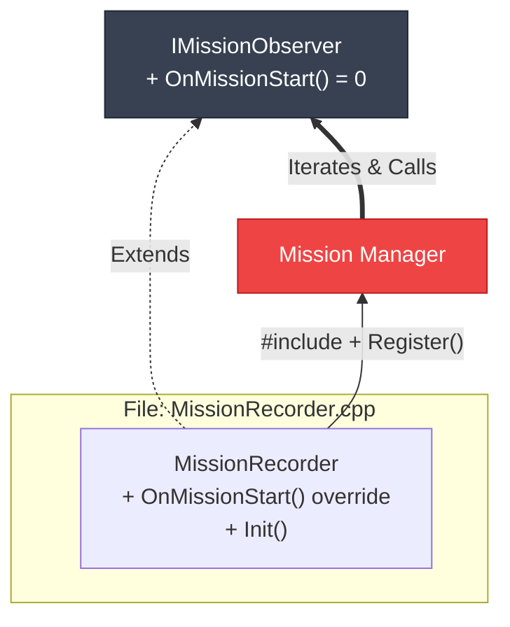
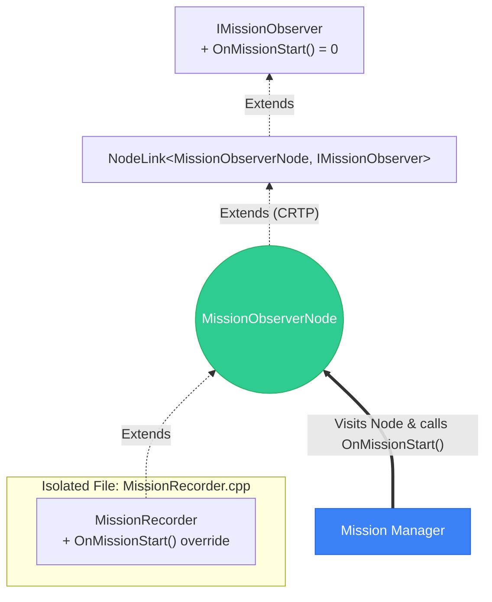
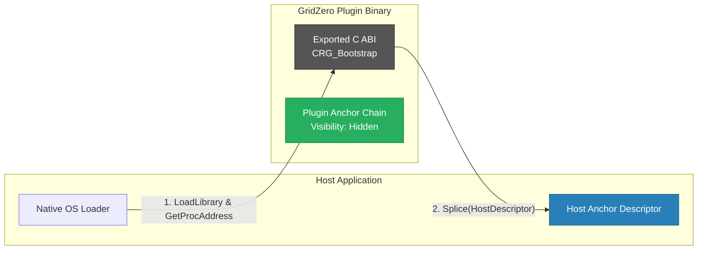
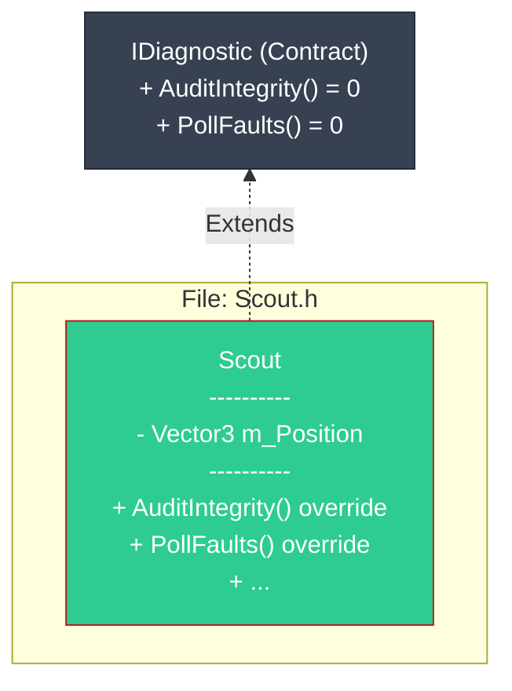
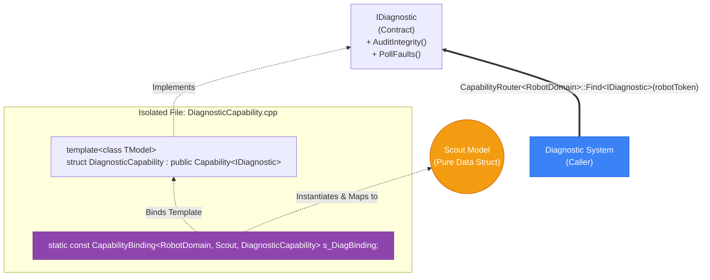
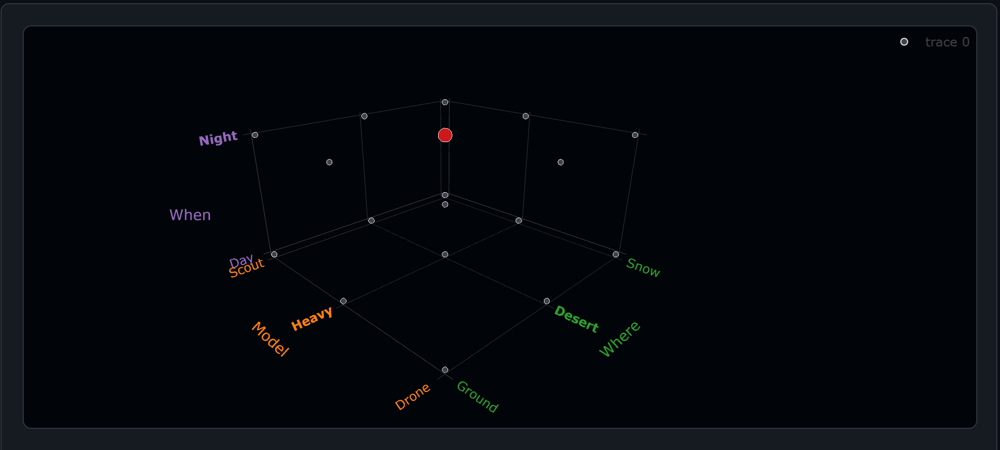
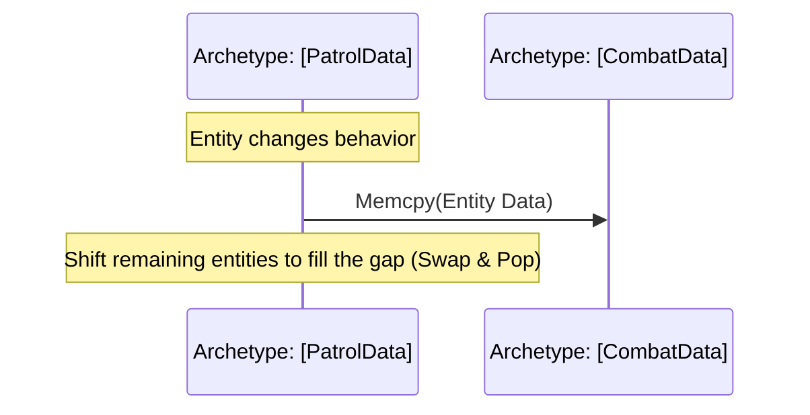
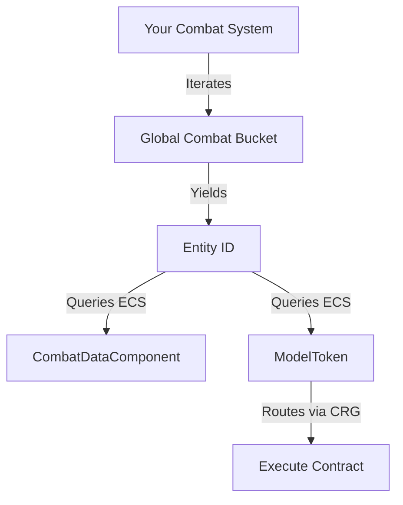
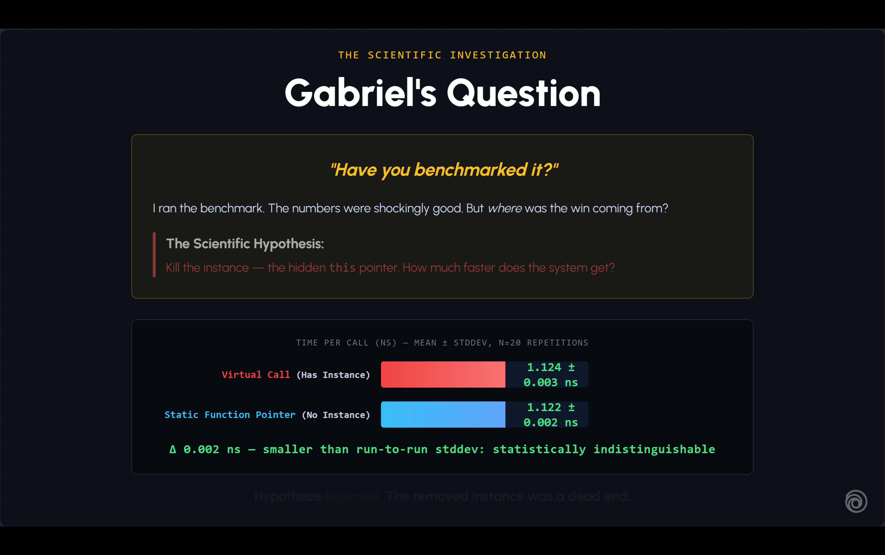
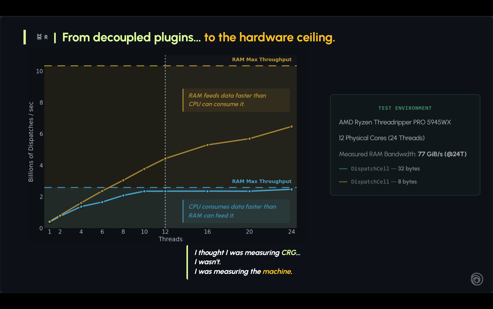

# GridZero User Manual
## From Decoupled Plugins to the Hardware Ceiling
### *The Capability Routing Grid*


---

# Chapter 00: Hardware Affinity by Accident

## 0.1 The Architect's Manifesto & The Compile-Time Judge


<div align="center">
  
  <br>
  <em>Cyril Tissier, Programming Architect - CppCon2026</em>
</div>


My name is Cyril Tissier, and as a Programming Architect, a large part of what I do comes back to the same question: how do I make programmers' lives simpler? Whenever I can, I try to push complexity into compile time — catch mistakes earlier, cut runtime cost, and make certain mistakes simply impossible by construction. My core philosophy is absolute: the engine room must absorb the complexity to protect the KISS (Keep It Simple, Stupid) principle on the outside.

**If it is complicated, it is the wrong approach.**

Many programmers force themselves to write endless unit tests (or not) just to validate that their architecture is wired correctly. My approach is different: if a validation can be done at compile-time, I jump on it. If I can design the code so that an invalid architectural connection simply *fails to compile*, the compiler has already performed the ultimate, unbypassable unit test.

This architecture, the **Capability Routing Grid (CRG)**, is anchored in pure C++17. I mercilessly exploit the full power of modern metaprogramming to weave this routing grid. But let me reassure you immediately: **this complexity is strictly confined to the engine room**. For the domain developer using this architecture, the Developer Experience (DX) is one of absolute simplicity. 


## 0.2 The Coupling Problem

Every C++ architect working on a large-scale project knows the true pain of coupling. You design a pristine architecture on a whiteboard. You separate your domains perfectly: the "Data" lives in Project A, and the "Interfaces" (the contracts for your logic) live in Project B. 

But traditional C++ forces a physical constraint on you: a class must declare its capabilities in its own header. The moment you want to attach Project B's behaviors to Project A's data, Project A is forced to `#include` Project B's interfaces. Slowly, project by project, your elegant design degrades into a tangled, monolithic web of dependencies.

The title of this journey is *"From Decoupled Plugins to the Hardware Ceiling"*. At first glance, it feels like two completely different concepts: one about pure software architecture, and another about low-level hardware performance. But throughout these pages, I am going to show you that **removing dependencies and feeding the hardware are two sides of the same coin**.

The CRG architecture rests on exactly four pillars: **Decoupling. Decoupling. Decoupling. And... Decoupling.**


## 0.3 The False Dilemma & The Pathology

Historically, software architecture and hardware affinity were treated as a strict trade-off:

*   **Clean OOP (Physical Decoupling):** We use abstract virtual interfaces. Clean headers, fast compilation. But we accept a runtime cost: cache misses and pointer dereferences. Modularity isolates our code, and the hardware pays the price.
*   **Hardware Affinity:** We use templates and compile-time generic programming to buy raw, inlined performance. But by moving logic into templates, we drag implementation details directly into headers, triggering massive contagion across the include graph.

CRG exists to prove that trade-off isn't necessary.

We are told we must choose between runtime performance and iteration speed. CRG refuses this compromise. Instead of treating the symptoms, we must attack the root pathology. And this pathology exists at two different scales:

*   **Project Coupling (The Macro Pathology):** Modules that should evolve independently need a centralized coordinator (a registry, an init phase, a manager) to connect them. The industry understands this one well. Adding a feature means touching a central manager and triggering a massive rebuild.
*   **Identity Coupling (The Micro Pathology):** State and behavior that should evolve independently get fused into the same identity. We pollute data structures with virtual methods and business logic. The industry largely ignores this one.

Different scales, but the exact same disease: things that should be independent, are not.


## 0.4 The Discovery

I will be completely honest with you: I did not design the CRG to break hardware performance records. I also didn't design it to optimize build times. I wasn't trying to reinvent software architecture. 

Originally, I built this simply to solve an OOP challenge: binding new, isolated behaviors across strictly segregated projects. And it worked. It could have been the end of the story...

Then my colleague Jean-Baptiste asked me: *"Would this work with a strictly data-oriented model like an ECS?"*
So I built a prototype... And Gabriel asked: *"Have you benchmarked it?"*

I hadn't measured a thing. I fired up the profiler. The numbers looked wrong. Not bad. *Wrong*. They were simply too good. 
This was exactly the kind of thing I can't leave alone. My brain kept generating explanations and tearing them down. I routinely wake up to jot down notes in the middle of the night just to dump my brain and find a way back to sleep. 

That was it. On my Apple Silicon Mac, the entire dataset fit inside the cache. I wasn't measuring RAM. I was measuring cache. I immediately rewrote the benchmark, padded the entities, and forced the footprint into main memory, bracing for the illusion to shatter.

It didn't. The results held. By pushing isolation to its limit, the architecture had accidentally aligned with the hardware. 

**Performance wasn't the discovery. Performance was the evidence...**


## 0.5 The Adoption Reality: An "À La Carte" Toolkit

A common misconception when discussing hardware ceilings is that CRG must be an all-or-nothing framework reserved strictly for Data-Oriented engines. This is false. CRG is fundamentally about establishing a sane, maintainable architecture. It is a progressive, "à la carte" toolkit: you use it where you want, when you want, and if you want.

*   **For Architectural Sanity:** Are you tired of maintaining centralized initialization registries? Do you want to drop a `.cpp` file in an isolated project and have it automatically participate in the engine? You don't need to care about cache lines to benefit from collaboration via existence.
*   **For Dynamic Plugins & Hot Reloading:** Because the architecture relies on dynamic anchor splicing rather than hardcoded registries, it naturally supports hot injection. You can dynamically load, unload, or hot-reload behaviors safely.
*   **For Targeted Optimization:** You do not have to rewrite your entire codebase. You can absolutely maintain a traditional OOP architecture for your high-level logic, and use CRG exclusively to drive a specific, CPU-heavy subsystem—like a massive crowd simulation.
*   **For Extreme Performance:** Reaching the absolute hardware ceiling is achieved specifically when the routing grid works in perfect symbiosis with a strict Entity Component System (ECS), ensuring data remains completely immobile.


## 0.6 The Map

So that's the journey ahead. Each coupling we remove delivers a standalone architectural asset in pure C++17.
Chapter 01 removes Project Coupling. But Identity Coupling is the deeper disease, and it has three faces. Chapter 02 removes Behavioral Coupling. Chapter 03 removes Topological Coupling. And Chapter 04 removes Residency Coupling.

If I do my job right, you won't leave this manual thinking about CRG. You'll leave thinking about coupling.


---

## Acknowledgments

Special thanks to **Sébastien Clavaud** for taking the time to review this manual and for his valuable feedback on its structure and clarity.

---


# Chapter 01: Collaboration via Existence

## Removing Project Coupling

### *We do not remove communication. We remove mutual awareness.*


## 1.1 The Centralized Registry Trap (The Industry Way)

At project scale, modules that should evolve independently are almost always forced to know about a central coordinator. 

If you want to add a new feature—like a `MissionRecorder` observer—to an existing engine, what does the industry standard tell you to do? You modify a dispatcher, update a central registry, and append a line to a massive initialization phase. 

This is Project Coupling. The components have clean interfaces, but their existence is tangled in global knowledge. The architecture forces you to maintain a hardcoded map of the world just to let two systems talk. You end up touching unrelated files, recompiling large chunks of the project, and risking merge conflicts simply because a new module exists.

To understand the solution, let's look at how the industry currently achieves decoupling through abstract interfaces. 

Imagine a large-scale platform with a `CoreSystem` library dispatching events, and a separate `Telemetry` library listening to them. Physically, the interface headers are clean: `MissionRecorder` inherits from `IMissionObserver`, and neither project includes the other's implementation. 

Yet, isolation is not collaboration. Before `MissionRecorder` can contribute, some discovery mechanism must connect the two. 

*The Industry Way:* We build a centralized `MissionManager`.



Every module must explicitly register itself. We decoupled the logic through the interface, but we leaked the physical dependency: `MissionRecorder` must `#include "mission_manager.hpp"` and call `MissionManager::Get().Register(this)`. 

This centripetal architecture forces an explicit `Init()` phase for every subsystem, creating a sequential bootstrapping bottleneck. 

The interesting question is not: *how do we build a better coordinator?* 
The interesting question is: **what if participation required no coordinator at all?**


## 1.2 Drop a .cpp. Inherit. Declare. Done.

Most architectures assume that communication requires knowledge. CRG completely breaks that rule. We are not removing communication; we are removing mutual awareness.



### **1.2.1 The CRG Infrastructure (The Bridge Header)**

To link the domain contract to the CRG routing system without creating physical dependencies, we create a dedicated bridge header. This header establishes the shared registration point and declares the **Universal Anchor**, telling the compiler that a head pointer exists for this discovery chain.

```cpp
// 📄 mission_observer_node.hpp (Engine/Infra Project)
#pragma once
#include "mission_observer.hpp"
#include <discovery/node_link.hpp>

// The Bridge: Connects the domain contract to CRG discovery
struct MissionObserverNode : public crg::NodeLink<MissionObserverNode, IMissionObserver> {
};

// Exposes the anchor point to anyone including this bridge
CRG_DECLARE_NODE_LINK(MissionObserverNode);
```

### **1.2.2 The Plugin-Enabled Implementation (The Bridge CPP)**

The anchor must physically exist somewhere in memory. The Host defines it once inside a dedicated `.cpp` file:

```cpp
// 📄 mission_observer_node.cpp (Engine/Infra Project)
#include "mission_observer_node.hpp"

// Creates the actual storage for the anchor. 
// Exports the symbol if building a DLL Host, imports if building a Plugin.
CRG_DEFINE_NODE_LINK(MissionObserverNode);
```

In a monolithic build, this anchor acts as the single registration point. With plugins, multiple independent chains may exist; the anchor provides the shared rendezvous point that allows CRG to unify them.

> **Rule:** Every CRG contract requires exactly one `CRG_DEFINE_NODE_LINK(...)` in the Host executable.

### **1.2.3 The Concrete Implementation**

Now, look at the Developer Experience. To add a new observer, you drop a new `.cpp` file, include the bridge, inherit, and declare your implementation. That's it. 

```cpp
// 📄 telemetry_plugin.cpp (Telemetry Project)
#include "mission_observer_node.hpp"

namespace {
    struct MissionRecorder : public MissionObserverNode {
        void OnMissionStart() override { 
            // Telemetry logic executes here
        }
    };

    // Collaboration via existence. 
    // Registration executes automatically before main() via the bridge infrastructure.
    static const MissionRecorder s_recorder;
}
```

Notice the anonymous namespace. `MissionRecorder` is strictly invisible to the rest of the project. 

Under the hood, the engine room absorbs the complexity: constructors automatically chain themselves to the Universal Anchor sequentially before `main()`, eliminating race conditions and central registries entirely. Topology becomes coordination.


## 1.3 Mutual Anonymity & The Shared Contract

```cpp
// 📄 mission_manager.cpp (CoreEngine Project)
#include "mission_observer_node.hpp"

void MissionManager::NotifyStart() {
    MissionObserverNode::Visit(
        [](const IMissionObserver& observer) noexcept { observer.OnMissionStart(); });
}
```

This is mutual anonymity. `MissionManager` includes exactly the same bridge header as the concrete implementations. Nothing else. Neither includes the other.

The `MissionManager` has no idea whether a `MissionRecorder` exists—or where it lives in the project tree. The project-level coupling is entirely gone.


## 1.4 Advanced Usage: Optional Execution Ordering (SortCache)

*Note: This section covers advanced customization. For standard decoupled systems, default registration order is sufficient.*

By default, nodes register in the order of their static initialization, which depends on the linker and is non-deterministic. If your domain requires a strict execution sequence, you can hook into the caching mechanism.

Sorting metadata belongs strictly to the infrastructure, not the domain contract. You define the routing rules in your Bridge Node and specialize `crg::discovery::NodeLinkTraits`:

```cpp
// 1. Add custom priority interface to the Bridge Node
struct MissionObserverNode : public crg::NodeLink<MissionObserverNode, IMissionObserver> {
    virtual int GetPriority() const { return 0; }
};

// 2. Specialize the trait in the Bridge Header
template<>
struct crg::discovery::NodeLinkTraits<MissionObserverNode> {
    static void SortCache(std::vector<const MissionObserverNode*>& cache) {
        std::sort(cache.begin(), cache.end(),
            [](const MissionObserverNode* a, const MissionObserverNode* b) {
                return a->GetPriority() < b->GetPriority();
            });
    }
};
```

When implementing a plugin, the developer simply overrides `GetPriority()` if an ordered sequence is required. The engine detects this trait at compile-time and automatically applies the sort before dispatching `Visit()`.


## 1.5 Crossing the ABI: Plugin Isolation & Lifecycle

Transitioning to a dynamic plugin system requires crossing the ABI boundary without introducing a centralized loader. The core challenge is preventing the C++ compiler from aggressively merging template statics across shared libraries, which would destroy the decentralized routing topology.

### 1.5.1 The ABI Boundary & Memory Isolation

The build system must enforce strict memory isolation. By default, compilers attempt to merge inline variables and template statics across DLL boundaries. In a zero-registry architecture, this breaks anchor resolution and tangles local discovery chains.

Using GridZero's CMake API (`cmake/crg_plugin_api.cmake`), the `crg_add_plugin` and `crg_add_host` functions apply the `CRG_PLUGINS_ENABLED=1` definition. Crucially, they enforce isolation by setting visibility to `hidden` for both standard symbols and inline variables. If using Sharpmake, you must explicitly set `Options.Gcc.Compiler.Visibility.Hidden` and `Options.Gcc.Compiler.VisibilityInlinesHidden.On` to replicate this Clang/GCC behavior.

### 1.5.2 Exposing the Plugin: The End of Export Macros

The contemporary industry approach to shared libraries relies on scattering `__declspec(dllexport)` or `__attribute__((visibility("default")))` macros across every exposed C++ class and method. This practice leaks complex C++ ABI details across the boundary, introduces fragility with STL containers, and tightly couples the plugin's internal memory layout to the host.

CRG completely breaks that rule. **The plugin implementation requires no knowledge of the host and exposes no C++ types.** 

A single `CRG_DEFINE_PLUGIN(<Name>)` macro in one compilation unit generates and exports exactly two C ABI entry points: `CRG_Bootstrap` and `CRG_Shutdown`. This creates a stable, layout-agnostic bridge to manipulate the plugin's internal anchor chain without exposing its nodes.

### 1.5.3 The Integration Surface

The integration surface is limited to native OS calls (`LoadLibrary` on Windows, `dlopen` on POSIX). The ABI boundary acts as a strict shield, isolating the C++ capabilities while allowing the routing topology to merge dynamically.



The host loads the binary, resolves the `CRG_Bootstrap` function pointer, and passes a context containing its anchor descriptor. This operation splices the plugin's capabilities directly into the host's routing graph.

Here is the entire host side. Nothing but the OS loader and two symbol lookups is involved; the host links no GridZero `.cpp`:

```cpp
// 📄 host_loader.cpp (Host side)
#include <crg/crg.hpp>
#include <crg/plugin/plugin.hpp>
#include <crg/host/host_descriptor.hpp>
#include <windows.h>   // POSIX: <dlfcn.h>, dlopen / dlsym / dlclose

// 1. The host describes its own anchor chain
crg::host::HostDescriptor hostDesc;
hostDesc.m_HostAnchorsHead = crg::discovery::AnchorLink::GetLocalHead();

crg::host::CRG_Context ctx{};
ctx.m_HostDescriptor = &hostDesc;

// 2. Native load + the two entry points
HMODULE dylib = LoadLibraryA("greeter_plugin.dll");
auto bootstrap = reinterpret_cast<crg::plugin::PluginLoader::BootstrapFn>(
    GetProcAddress(dylib, crg::plugin::PluginSymbols::Bootstrap));
auto shutdown = reinterpret_cast<crg::plugin::PluginLoader::ShutdownFn>(
    GetProcAddress(dylib, crg::plugin::PluginSymbols::Shutdown));

// 3. Splice: the plugin's capabilities are now part of the host's grid
bootstrap(&ctx);

auto gate = crg::routing::CapabilityRouter<GreeterDomain>::Find<IGreet>(token);
IGreet::Params p{};
gate(p);   // runs the code that lives in the plugin

// 4. Unsplice, then (and only then) unload the binary
shutdown();
FreeLibrary(dylib);
```

After `shutdown()`, `Find<IGreet>(token)` returns an empty gate again: the grid is back to its exact pre-load state.

### 1.5.4 Clean Teardown (CRG_Shutdown)

When a module is unloaded or during a system teardown, the host must sever the connection before freeing the memory.  Calling the exported `CRG_Shutdown` function reverses the anchor splice and triggers a cache refresh, restoring the arena topology to its exact pre-load state. Only then does the host call `FreeLibrary` or `dlclose`, guaranteeing no dangling pointers remain in the routing tensor.

### 1.5.5 Overrides via Existence

Cells inside the routing space are progressively painted by participating modules. As a result, extension, patching, and behavior replacement all follow the same mechanism: a later contribution simply paints over an existing cell. No dedicated override registry or replacement framework is required.


---

> **That is the Open/Closed Principle** — not as a rule you follow with discipline,
> but **as a structural guarantee the linker enforces for you**.

---


# Chapter 02: Polymorphism via Capability

## Removing Behavioral Coupling

### *We do not remove polymorphism. We remove where polymorphism lives.*


## 2.1 The Fat OOP Class Trap (The Industry Way)

To understand behavioral decoupling, we must look at the traditional OOP approach. The industry standard fuses identity, state, and behavior into a single, massive entity.

Imagine a robotics framework with a generic `Entity` system. We need a `Scout` entity that has diagnostic capabilities. 

*The Industry Way:* We build a Fat Class with inheritance and virtual tables.



The `Scout` class becomes a magnet for dependencies. To implement `AuditIntegrity()`, `Scout.h` must now include diagnostic subsystems. To implement `UpdatePhysics()`, it includes the physics solver. The model is no longer pure data; it is a heavy, bloated construct carrying the physical dependencies of every system it interacts with. 

Identity dictates behavior. The object instance is required to resolve the logic.


## 2.2 The Tensor Grid (The CRG Way)

Most architectures assume that identity dictates behavior. CRG completely breaks that rule. We separate the pure data from the logic. The behavior is moved into an external, isolated **Capability**. 

To attach domain-specific Capabilities to pure data structs without polluting their headers, I rely on a **Tensor Grid** (or Capability Matrix). Instead of a traditional virtual table buried inside an object, it is a global, static map of capabilities injected by isolated projects.




## 2.3 Domains & The Universal Passport

Before we can route logic through the grid, the system needs to know what an entity is. It needs an identity. To achieve extreme decoupling, we relentlessly separate the domain space, the pure data, and their association into distinct headers.

### 1. The Domain Definition

To organize identities, CRG introduces **Domains**. A Domain acts as a discriminator to isolate routing tables. 

```cpp
// 📄 robot_domain.hpp (Project: Infrastructure)
#pragma once
#include <crg/domain.hpp>

// 1. A stateless tag representing the isolated routing space
struct RobotDomain {};

// 2. Declare the domain to the CRG system
CRG_DECLARE_DOMAIN(RobotDomain)
```

We define a pure, empty C++ struct to represent the domain. The `CRG_DECLARE_DOMAIN` macro then registers this isolated routing space. This ensures that behaviors targeting `RobotDomain` will never collide with, say, an event dispatcher domain.

### 2. The Pure Data Payload

Next, we define our entity. The data structure must remain totally agnostic so it can be consumed by other systems (rendering, networking, physics) that care nothing about the CRG framework.

```cpp
// 📄 scout.hpp (Project: Data)
#pragma once
#include <math/vector3.hpp>

// A pure data aggregate. No logic, no vtable, no framework dependencies.
struct Scout { 
    Vector3 Position;
};
```

Look at `Scout`. It is still just data. No trace of `Diagnostic`, no inheritance, no virtual methods. 

### 3. The Universal Passport

So how does the system recognize `Scout` dynamically without a virtual table? We associate the pure data model with its routing domain.

```cpp
// 📄 robot_models.hpp (Project: Engine / Integration)
#pragma once
#include "robot_domain.hpp"
#include "scout.hpp"

// Register the pure data model into the routing space.
CRG_DECLARE_DOMAIN_MODELS(RobotDomain, Scout)
```

With this single macro, the compiler generates the "Universal Passport" for the model. By turning type identity into pure math, we completely bypass RTTI. 

Identity in CRG is generated at compile time from the model type. Because it is deterministic, it remains stable across binaries, plugins, and toolchains. It is completely independent from RTTI and becomes a routable destination inside the grid.


## 2.4 Drop a .cpp. Inherit. Declare. Done. (The Capability DX)

Look at the developer experience. To add a new capability, we define an agnostic contract, drop a new `.cpp` file for its implementation, and bind it. 

First, the contract. Notice how `IDiagnostic` is completely isolated from any specific data type.

```cpp
// 📄 diagnostic.hpp (The Contract)
#pragma once
#include <string_view>
#include <crg/core/hash.hpp>

struct IDiagnostic {
    virtual std::string_view GetModelTypeName() const = 0;
};
CRG_DECLARE_CONTRACT(IDiagnostic)
```

`CRG_DECLARE_CONTRACT` gives the contract its identity: a compile-time hash of its fully qualified name, with no RTTI involved. The router uses it, together with the domain, to locate the contract's slice of the grid, so using a contract that was never declared (for example in `CapabilityRouter<Domain>::Find<IDiagnostic>`) fails at compile time. Because the hash comes from the name rather than from an address, a contract declared in a header shared by the host and a plugin resolves to the same slice on both sides of the DLL boundary. Declare it once, in the contract's header, right after the type.

Then, the implementation. We drop a new `.cpp` file. Because our capability inherits as a template, it intrinsically knows which `TModel` it represents, even though the contract does not.

```cpp
// 📄 diagnostic_capability.cpp (Isolated Implementation)
#include "diagnostic.hpp"
#include "scout.hpp"
#include "robot_domain.hpp"
#include <crg/models/model_key.hpp>
#include <crg/capabilities/capability_binding.hpp>

namespace {
    // 1. The Behavior (Template bound to the pure data model)
    template<class TModel>
    struct DiagnosticCapability : public crg::capabilities::Capability<IDiagnostic> {
        
        std::string_view GetModelTypeName() const override {
            // The macro CRG_DECLARE_DOMAIN_MODELS automatically generated 
            // the name trait for us. We just retrieve it.
            return crg::models::ModelKey<TModel>::Name;
        }
    };

    // 2. The Linker Routing
    static const crg::capabilities::CapabilityBinding<
        RobotDomain, Scout, DiagnosticCapability> s_DiagBinding;
}
```

Notice how the anonymous namespace ensures our `DiagnosticCapability` is invisible to the rest of the project. To make it work, you just declare a `CapabilityBinding` to wire the pure data model to the behavior.

**The Stateless Mandate:** 
Capabilities must never hold internal state. They are pure shared behaviors. This is why bindings are declared strictly as `static const`. This enforces their global, unique, and immutable nature. It guarantees 100% thread-safe execution (zero locks) and flawless plugin integration, passing pure interface pointers across DLL boundaries.


## 2.5 The Call Site: CapabilityRouter

State and behavior are now completely decoupled. How does the engine trigger this behavior at runtime? 

First, we need the entity's Universal Passport. We retrieve it securely from the pure data type.

```cpp
// Generating the token from the pure data type
auto robotToken = crg::models::ModelToken<RobotDomain>::FromType<Scout>();
```

Once we have the token, we ask the **CapabilityRouter** to find the behavior.

```cpp
// 📄 diagnostic_system.cpp (The Caller)
#include "diagnostic.hpp"
#include "robot_domain.hpp"
#include <crg/models/model_token.hpp>
#include <crg/routing/capability_router.hpp>
#include <iostream>

void PrintDiagnosticName(crg::models::ModelToken<RobotDomain> robotToken) {
    // 1. Query the grid for the capability using the token
    auto cap = crg::routing::CapabilityRouter<RobotDomain>::Find<IDiagnostic>(robotToken);

    // 2. Safely execute if the capability exists for this model
    if (cap) {
        std::cout << "Running diagnostic for: " << cap->GetModelTypeName() << "\n";
    }
}
```

The caller operates entirely in the abstract. It asks the `CapabilityRouter` to perform an O(1) lookup within the `RobotDomain` to find the `IDiagnostic` contract for a specific `ModelToken`. 

Notice the use of `auto cap`. We do not hardcode a specific handle type. This is crucial for future-proofing: today the router might return a wrapped interface pointer, but tomorrow it could return a pure function pointer for performance. Using `auto` keeps our caller code completely immune to underlying architectural shifts.


## 2.6 The Matrix Problem & TypeLists

We have established a perfectly decoupled 1:1 relationship between a data model and a capability. But large-scale systems are not built on 1:1 relationships. They are built on massive combinatorial matrices.

Suppose your `RobotDomain` grows to include 50 different entity types (`Scout`, `Drone`, `HeavyLifter`, `Walker`, etc.). If you write a universal `DiagnosticCapability` that applies to all of them, the standard approach requires manually writing 50 binding declarations. 

```cpp
// The Boilerplate Hell (What we want to avoid)
static const crg::capabilities::CapabilityBinding<RobotDomain, Scout, DiagnosticCapability> b1;
static const crg::capabilities::CapabilityBinding<RobotDomain, Drone, DiagnosticCapability> b2;
static const crg::capabilities::CapabilityBinding<RobotDomain, HeavyLifter, DiagnosticCapability> b3;
// ... 47 more lines
```

This is the Matrix Problem. It leads to human error, forgotten bindings, and maintenance friction.
In CRG, we solve this combinatorial explosion natively using **TypeList**. 

```cpp
// --- robot_domain.hpp (Shared Domain Header) ---
#pragma once
#include <crg/core/type_list.hpp>

#include "models/scout.hpp"
#include "models/drone.hpp"
#include "models/heavy_lifter.hpp"

// 1. Group the models into a shared TypeList alias
using AllRobots = crg::TypeList<Scout, Drone, HeavyLifter>;
```

```cpp
// --- diagnostic_capability.cpp ---
#include "robot_domain.hpp"
#include "diagnostic_capability.hpp"

namespace {
    // 2. Bind the capability to the entire list instantly
    static const crg::capabilities::CapabilityBinding<RobotDomain, AllRobots, DiagnosticCapability> s_DiagBindings;
}
```

A single binding declaration applies the capability to the entire family. The compiler automatically generates the complete binding matrix for every model contained in the TypeList.


## 2.7 The Virtual Template Wall & ModelShell

We have successfully extracted behavior into Capabilities and reduced Models to pure data. But if you are integrating with an existing object-oriented engine, you still need a way to pass this data dynamically across project boundaries—for instance, when bridging heterogeneous events or messages.

*(Note: If you are building a pure Data-Oriented system or a strict ECS, you will never need `ModelShell`. You will route directly using `ModelToken` over raw contiguous arrays. `ModelShell` exists exclusively as an optional bridge to solve the OOP boundary problem).*

Standard architectures solve dynamic routing with a base class pointer. They force you to derive every payload from a common `IEvent` or `IMessage` interface, leading to sprawling inheritance trees and heap-allocated polymorphic pointers simply to transport a concrete data struct across boundaries. But in CRG, our models and payloads are raw structs. They have no base class. 

The dream is simple: a virtual template method. But C++ outright forbids it. It is structurally impossible. We need a different tool to cross this boundary.

CRG solves this using the `ModelShell<TDomain>`. 

`ModelShell` is a specialized form of Type Erasure. A classical Type Erasure pattern carries identity, state, and behavior together. But here, the behavior has already been extracted. Only identity and state remain. `ModelShell` just needs to store a model, erase its type at the boundary, and safely recover it inside the Capability.

### 2.7.1 The Universal Transporter

The `ModelShell` allows you to pass any concrete type to a Capability without ever duplicating interfaces for each specific model. 

It is strictly a **FixedSize** buffer templated by `DOMAIN`. If a model's size exceeds the domain's configured buffer, it fails strictly at compile time via `static_assert`. This guarantees zero runtime allocations and perfect cache-line adherence.

### 2.7.2 Buffer Customization (Optional Traits)

By default, the shell uses `CRG_MODEL_SHELL_SIZE` and `CRG_CACHE_LINE_SIZE`. You only need to define `ModelShellTraits` if you explicitly want to override these defaults for a specific domain.

```cpp
namespace crg::shell {
    // Optional: Override the defaults for the RobotDomain
    template<> struct ModelShellTraits<RobotDomain> {
        static constexpr std::size_t MaxSize      = 128; // Strict byte limit
        static constexpr std::size_t MaxAlignment = 64;  // Cache-line aligned
    };
}
```

### 2.7.3 The Contract & The Trampoline Capability

To cross the virtual template wall, the routed interface must accept `const crg::shell::ModelShell<TDomain>&` as its **first and mandatory argument**. It can then take any number of arbitrary trailing arguments.

Inside the capability, the type-erasure is safely undone. A best practice here is to treat the capability purely as a routing trampoline. It unpacks the shell and forwards the real data to a concrete handler. 

To maintain extreme decoupling, the data module remains pure and knows absolutely nothing about this logic. Instead, the capability uses a forward-declared template structure, and the developer provides the specialized implementation strictly within the capability's own translation units.

```cpp
// 1. The Contract: First arg MUST be the shell. Trailing args are supported.
struct IDiagnostic {
    virtual void PrintStatus(const crg::shell::ModelShell<RobotDomain>& shell, int logLevel) const = 0;
};

// 2. The Concrete Logic Handler (Forward Declared)
template<typename T>
struct DiagnosticHandler;

// 3. The Capability: Just a trampoline
template<typename TModel>
struct DiagnosticCapability : crg::capabilities::Capability<IDiagnostic> {
    void PrintStatus(const crg::shell::ModelShell<RobotDomain>& shell, int logLevel) const override {
        // Undo erasure with Cast<TModel>() and delegate.
        // If DiagnosticHandler<TModel> isn't specialized, it fails at compile time!
        DiagnosticHandler<TModel>::PrintStatus(shell.Cast<TModel>(), logLevel);
    }
};

// --- In the Capability Translation Unit (e.g., diagnostic_scout.cpp) ---
// The Scout data struct remains purely data. The logic is injected here.
template<>
struct DiagnosticHandler<Scout> {
    static void PrintStatus(const Scout& scout, int logLevel) {
        // Actual business logic operating on the concrete Scout data...
    }
};
```

### 2.7.4 The OOP Illusion

While you can route manually, CRG provides `Invoke` and `TryInvoke` as a deliberate OOP illusion. To the caller, this API looks and feels exactly like a standard object-oriented method call. But underneath, there is no polymorphic object, no vtable, and no hidden `this` pointer.

This illusion is backed by strict compile-time validation: the target method's first parameter is imperatively checked to ensure it is `const ModelShell&`. Any subsequent arguments passed to `Invoke` are perfectly forwarded to the capability.

Unlike `Invoke`, which aggressively asserts if a shell is empty or a binding is missing, `TryInvoke` is designed for safe, optional execution. It gracefully massages the return type using C++17 type traits:

* If the routed method returns `void` -> `TryInvoke` returns `void` (doing nothing on failure).
* If the routed method returns `T` -> `TryInvoke` returns `std::optional<T>` (evaluating to `{}` on failure).
* If the routed method already returns `std::optional<T>` -> `TryInvoke` returns `std::optional<T>` directly (preventing double-wrapped optionals).

```cpp
Scout myScout{};
crg::shell::ModelShell<RobotDomain> shell(myScout);
int level = 2;

// Invoke: Resolves interface, forwards args. Asserts if empty/unbound.
shell.Invoke<&IDiagnostic::PrintStatus>(level);

// TryInvoke: Graceful fallback if shell is empty or Scout has no binding.
// Returns void, because PrintStatus returns void.
shell.TryInvoke<&IDiagnostic::PrintStatus>(level);

// Example with a return type:
// auto result = shell.TryInvoke<&IDiagnostic::GetSeverity>();
// result is std::optional<int>. Evaluates to false if unbound or shell empty.
```

The Virtual Template Wall is **bypassed**: the caller uses a single wrapper, the boundary only sees a fixed-size shell, and the capability seamlessly bridges the gap back to the fully decoupled concrete data.


---

> **That is true separation of concerns** — not as a rule you follow with discipline,
> but **as a structural guarantee the compiler enforces for you**.

---


# Chapter 03: Routing via Geometry

## Removing Topological Coupling

### *The CPU isn't slow. The CPU was asking questions.*


## 3.1 The Confession: `Find()` Was Still a Search

Under the hood, the very first prototype of CRG executed a linear scan. 

```cpp
template<class TContract, typename... TArgs>
auto Find(u64 modelHash, const TArgs&... args) {
    CapabilityHandle<TContract> result;

    // O(N) conditional loop. Topology is leaking into execution.
    CapabilityNode::Visit([&result, modelHash](const CapabilityNode& n) {
        if (n.GetHash() == modelHash) {
            result = n.GetContract();
            return false; // Match found: stop traversing
        }
        return true;      // Continue traversing
    });

    return result;
}
```

When profiling, the natural instinct is to look at the algorithmic complexity and blame the O(N) lookup. But O(N) is just a symptom. The data structure itself wasn't the root of the pathology. 

The real problem is that the CPU was being forced to ask questions. 

*Is this the hash? No.*  
*Is this it? No.*  

At the hardware level, every `if` statement—every branch—is a question. Every question introduces uncertainty. Every uncertainty is a hardware risk. A misprediction means flushing the pipeline and wasting dozens of cycles. 

As long as the system has to ask *where* the code is, it remains topologically coupled to a search structure. 
**A perfect architecture doesn't ask questions, it computes answers.**


## 3.2 From Branches to Dimensions (The Coordinate Space)

Most architectures assume that finding a capability requires traversing a topology—looking up a key in a `std::map`, walking a tree, or iterating through a list. CRG completely breaks that rule.

A perfect architecture doesn't ask questions. It computes answers. To reach the hardware ceiling, we had to stop searching and start executing. We had to exile the search to the startup phase, and turn the runtime routing into pure geometry.

### 3.2.1 The Naive Approach

Let's look at the naive state of behavior. Imagine a locomotion system that depends on context. We have two simple enumerations: `Where` (Ground, Desert, Snow) and `When` (Day, Night). 

In a standard setup, these contextual coordinates go straight into the capability method as arguments, forcing the behavior to sort out the logic internally:

```cpp
template<typename TModel>
struct LocomotionCap : crg::capabilities::Capability<ILocomotion> {
    void Move(Where location, When timeOfDay) override {
        if (location == Where::Desert && timeOfDay == When::Night) {
            // Apply desert night modifiers...
        } else if (location == Where::Snow) {
            // Apply snow modifiers...
        }
        // Fallback logic...
    }
};
```

The caller and the capability are tangled together. `Move()` is asking its own questions. Desert friction, night visibility—every context adds an `if`. Topology is hiding inside the behavior.

### 3.2.2 Defining the Axes (RoutingTraits)

> **Architectural Rule**
>
> **If a discrete parameter forces an `if` or a `switch` to fundamentally change the behavior, it is no longer just data. It is a structural dimension.**

We cannot build geometry out of continuous values (like a `float`). But enumerations, booleans, or specific discrete states (`Where::Desert`, `When::Night`) can be mapped to strict topological axes.

We stop passing `Where` and `When` to `Move()`. Instead, we wire these axes to the domain contract in the routing infrastructure. We declare that `ILocomotion` no longer lives in a 0-dimensional space, but inside a geometric volume.

```cpp
// Wires the axes into a routing space for ILocomotion
namespace crg::routing {
    template<> struct CapabilityRoutingTraits<RobotDomain, ILocomotion> {
        using SpaceType = CapabilitySpace<Where, When>; // Volume = 3 x 2 = 6
    };
}
```

### 3.2.3 The Tensor Volume

Consider the space we are now navigating:

*   **Model:** 3 values (Scout, Drone, Heavy)
*   **Where:** 3 values (Ground, Desert, Snow)
*   **When:** 2 values (Day, Night)

Three dimensions. 18 possible intersections. Together, they define a rigid volume—a 3D Grid. 



As a developer, your job is no longer to write nested `if` statements. The geometric space exists; your job is simply to fill its cells. Changing the coordinate physically changes the memory address. The Grid already knows where the answer lives.


## 3.3 Fallbacks & Specializations

To fill this geometric space without writing a single branch, CRG relies on a purely declarative approach. You don't write logic to route the execution; you bind behaviors to coordinates. 

Because `ILocomotion` is now formally bound to a `CapabilitySpace`, the definition of any capability implementing this contract **must** accept a second template parameter: `TAt`. This parameter represents the spatial coordinate.

### 3.3.1 The Fallback (Zero Branches)

First, you define the Fallback. This is your default capability. It acts as the base layer, filling the entire grid with a generic behavior so the system never crashes on an unhandled coordinate.

```cpp
// locomotion_cap.cpp — Isolated translation unit
namespace {

    // The Fallback. 
    // TAt is required because ILocomotion is bound to a CapabilitySpace.
    template<class TModel, class TAt> 
    struct LocomotionCap : Capability<ILocomotion> { 
        void Move() override {
            // Default generic movement
        }
    };
```

### 3.3.2 Specializations

Next, we specialize. Each specialization claims the cells it cares about with `crg::At`, and we do not write a single `if` statement: the coordinate is declared in the type system.

> **Best Practice: always end with `Remaining...`**
>
> Name the leading axes you care about, and wildcard everything after them with `auto... Remaining`. The day a developer adds a new axis to the space, every existing specialization keeps matching and no existing code has to be revisited.

```cpp
    // Desert, whatever the time of day (and whatever axes are added later)
    template<class TModel, auto... Remaining>
    struct LocomotionCap<TModel, crg::At<Where::Desert, Remaining...>>
        : Capability<ILocomotion> {
        void Move() override {
            // Desert movement
        }
    };

    // Night, whatever the location
    template<class TModel, auto where, auto... Remaining>
    struct LocomotionCap<TModel, crg::At<where, When::Night, Remaining...>>
        : Capability<ILocomotion> {
        void Move() override {
            // Night movement
        }
    };

    // The intersection: Desert AND Night.
    // Required: without it, (Desert, Night) matches both specializations above
    // and the compiler rejects the ambiguity.
    template<class TModel, auto... Remaining>
    struct LocomotionCap<TModel, crg::At<Where::Desert, When::Night, Remaining...>>
        : Capability<ILocomotion> {
        void Move() override {
            // Desert night modifiers
        }
    };
```

When two specializations can match the same cell, declare the intersection explicitly. The compiler then has a unique, most specific answer.

> **A Note on Architecture:**
> Traditional architectures constantly preach against massive monolithic methods filled with branching logic. Yet, developers keep writing them because grouping everything in one place feels intuitive.
>
> With CRG, that pressure disappears. Because you specialize templates per coordinate, you naturally break down complex logic into isolated, single-responsibility units. Clean architecture isn't enforced by code guidelines or convention anymore; it is structurally enforced by design.

### 3.3.3 The Binding

Finally, the declaration. You don't need to manually register the fallback and the specializations separately. You bind the root template once.

```cpp
    // The compiler builds the whole grid. No manual wiring.
    static const CapabilityBinding<RobotDomain, AllRobots, LocomotionCap> s_Bind;
}
```

The fallback automatically populates the entire space, while explicit specializations override only the coordinates you declare. As a user, you bind the capability once. CRG automatically builds the routing space from that declaration.

You just wrote a multi-dimensional routing system without a single branch.


## 3.4 Dynamic Rules & Continuous States

Geometry is incredibly fast, but it has a hard limit: it strictly requires discrete states. What happens when a business rule depends on a continuous value that cannot be mapped to an index—like a live temperature reading, or the exact charge level of a battery?

You cannot build a tensor axis out of infinite values. 

For these cases, CRG introduces the `RuleContext`. Geometry routes the execution to a tightly filtered subset of capabilities (a specific grid cell). From there, a dispatch cell evaluates the continuous conditions at runtime.

### 3.4.1 The RuleContext and the Config

First, you define the continuous data the rule needs inside the interface using a `RuleContext`. 

If a contract declares a `RuleContext`, CRG automatically enables dynamic routing for that contract. Then, you encapsulate the logic in a configuration struct exposing a `Condition()` predicate.

```cpp
// 1. The Interface defines the behavior and the continuous context
struct IPowerManagement {
    struct RuleContext { float m_BatteryCharge{ 0.0f }; };
    
    virtual void RoutePower() = 0;
    virtual ~IPowerManagement() = default;
};

// 2. The Config defines the dynamic rule
struct BatteryConfig {
    float m_MinCharge{ 0.0f };
    int   m_Priority{ 0 };   // Optional sorting key, used in 3.4.5
    
    bool Condition(const IPowerManagement::RuleContext& ctx) const {
        return ctx.m_BatteryCharge >= m_MinCharge;
    }
};
```

### 3.4.2 Binding the Cell (The Early-Exit Strategy)

Next, you attach this configuration to a concrete capability implementation. By associating a configuration with the capability, the `Condition()` predicate becomes part of the routing process.

By default, CRG uses an **Early-Exit** dispatch strategy. This means the router evaluates candidates in the order they are registered. The very first candidate whose `Condition()` returns `true` is selected, and the system immediately skips the rest.

```cpp
// Guarded candidate: Uses BatteryConfig. Only runs if condition is true.
template<typename TModel>
struct MaxThrustPower : public Capability<IPowerManagement, BatteryConfig> {
    MaxThrustPower() { this->m_Config.m_MinCharge = 20.0f; } // Cut off under 20%
    
    void RoutePower() override { 
        // Allocate full energy to heavy actuators
    }
};

// Fallback candidate: No config. Always matches if evaluated.
template<typename TModel>
struct PowerSaveMode : public Capability<IPowerManagement> {
    void RoutePower() override { 
        // Conserve energy, limit actuator speed
    }
};

// Bind them together. The guarded candidate (MaxThrust) is evaluated first.
namespace { 
    static const CapabilityBinding<
        RobotDomain, 
        AllRobots,
        MaxThrustPower, 
        PowerSaveMode
    > s_PowerBinding; 
}
```

At the call site, the router takes the `RuleContext` to resolve the logic. 

```cpp
// The dispatch cell resolves the condition.
auto gate = CapabilityRouter<RobotDomain>::Find<IPowerManagement>(
    token, 
    IPowerManagement::RuleContext{ 15.5f } // Below 20.0f, routes to PowerSaveMode
);

if (gate) {
    gate->RoutePower(); // Standard virtual call, no topology traversal attached
}
```

### 3.4.3 Mixing Geometry and Rules (The Call Site Order)

You are not forced to choose between discrete geometry and continuous rules; you can combine both for the same contract. 

When a contract relies on both a `RuleContext` and spatial axes, you must respect a strict argument order at the call site: the `RuleContext` must always be passed **before** the axis coordinates.

```cpp
// Correct call site argument order: RuleContext first, Axes last.
auto gate = CapabilityRouter<RobotDomain>::Find<IAdvancedLocomotion>(
    token, 
    IAdvancedLocomotion::RuleContext{ 85.0f }, // 1. Dynamic Rule data
    Where::Desert,                             // 2. Spatial Axis 1
    When::Night                                // 3. Spatial Axis 2
);
```

Passing these arguments out of order will result in a hard compilation error. 

### 3.4.4 Custom Strategies (Utility Scoring)

Early-Exit is perfect for binary thresholds, but it isn't always enough. For complex heuristics (like AI behaviors or thermal management), you might want to evaluate *all* valid candidates in the cell and pick the one with the highest score. 

You can override the dispatch strategy on a per-contract basis without touching the capabilities themselves. By defining `DispatchCellType` in the `CapabilityRoutingTraits`, you can inject a `UtilityScoringCell`. 

When using a scoring cell, your configuration struct must expose a float-based `Evaluate()` method instead of a boolean `Condition()`.

```cpp
// 1. The Config defines a scoring heuristic
struct HeatConfig {
    float m_BaseScore{ 1.0f };
    
    float Evaluate(const IThermalControl::RuleContext& ctx) const {
        // Returns a higher score as temperature rises
        return m_BaseScore * ctx.m_CoreTemperature;
    }
};

// 2. The Capability uses the HeatConfig
template<typename TModel>
struct EmergencyCooling : public Capability<IThermalControl, HeatConfig> {
    void Regulate() override { /* Open primary vents */ }
};
```

To tell the framework to use this strategy, you simply declare the appropriate dispatch cell for the contract:

```cpp
namespace crg::routing {
    template<> struct CapabilityRoutingTraits<RobotDomain, IThermalControl> {
        using SpaceType        = CapabilitySpace<>;
        using DispatchCellType = UtilityScoringCell<RobotDomain, IThermalControl>;
    };
}
```

Once declared, the router automatically evaluates all valid candidates and executes the highest-scoring behavior.

### 3.4.5 Custom Sorting for Dynamic Rules (DynamicRuleTraits)

By default, the `EarlyExit` dispatch cell evaluates dynamic rules in the exact order they are registered via the `CapabilityBinding`. If your business logic requires a custom sorting order (for instance, dynamically prioritizing specific conditional rules regardless of their registration sequence), you can opt in by specializing `DynamicRuleTraits`.

You define a sorting key inside your configuration struct, and write a custom `SortRules` hook:

```cpp
namespace crg::routing {
    template<>
    struct DynamicRuleTraits<RobotDomain, IPowerManagement> {
        // Exposes strongly-typed GetConfig() inside your sort lambda
        using ConfigBaseType = BatteryConfig;

        static void SortRules(std::vector<DynamicRule<RobotDomain, IPowerManagement>>& rules) {
            std::stable_sort(rules.begin(), rules.end(), [](const auto& a, const auto& b) {
                const auto* cfgA = a.GetConfig();
                const auto* cfgB = b.GetConfig();

                // Fallback capabilities (which have no config) return nullptr
                int prioA = cfgA ? cfgA->m_Priority : -999;
                int prioB = cfgB ? cfgB->m_Priority : -999;

                return prioA > prioB;
            });
        }
    };
}
```

When this trait is specialized, the framework automatically triggers the sort during the arena cache refresh. Unconditional fallbacks can be handled safely using a standard null pointer check on `GetConfig()`.


## 3.5 The Dispatch Cell: Opt-In Execution Strategies

A perfect architecture does not dictate how answers are computed; it only provides the geometric space for them to exist. 

CRG provides multiple dispatch strategies out of the box (`EarlyExitCell`, `UtilityScoringCell`, `BranchlessDispatchCell`). The appropriate choice depends entirely on your execution model.

### 3.5.1 Asynchronous Pipelines

System architecture is about recognizing *where* optimization matters. If your architecture employs an asynchronous pattern—where rule evaluation occurs at a low frequency (e.g., a 5Hz logic tick) while the chosen capability executes at high frequency (e.g., a 60Hz physics tick)—aggressively optimizing the rule selection is wasted effort.

In this model, the hardware ceiling is reached organically by the CRG infrastructure itself: eliminating central registries and invoking concrete capabilities directly. A straightforward, sorted `EarlyExitCell` perfectly satisfies the performance requirements.

### 3.5.2 Single-Pass Pipelines: The Unified Loop

However, not every architecture splits logic and execution into distinct phases. If your system relies on a single-pass pipeline—where routing decisions and execution occur simultaneously within the same unified loop—evaluating conditional rules per iteration for thousands of entities will shred your instruction cache.

This is exactly where developers must opt into **Branchless Dispatch**.

```cpp
namespace crg::routing {
    // Aggressive Branchless strategy for synchronous, high-frequency execution
    template<> 
    struct CapabilityRoutingTraits<RobotDomain, IMotorKinematics> {
        using SpaceType        = CapabilitySpace<>;
        using DispatchCellType = BranchlessDispatchCell<RobotDomain, IMotorKinematics>;
    };
}
```

#### The Rules of Branchless DX

When you opt into `BranchlessDispatchCell`, you trade the flexibility of standard evaluation for absolute, predictable hardware performance. To leverage this, you must design your capabilities around two strict constraints:

**1. The 64-Rule Limit**  
You cannot bind more than 64 capabilities to the exact same cell coordinate. Design your domain granularity and plugin distribution to comfortably fit within this capacity.

**2. The Stateless Config**  
Your configuration struct must be entirely stateless. It cannot hold any instance variables. All rule parameters must be strictly declared as `static constexpr` fields, and the runtime data to evaluate must flow entirely through the `RuleContext` provided by the caller.

```cpp
struct BranchlessConfig {
    // Rule parameters are strictly compile-time constants
    static constexpr float MIN_SPEED = 20.0f; 
    
    // Runtime data comes strictly from the Context
    bool Condition(const IMotorKinematics::RuleContext& ctx) const { 
        return ctx.m_Speed > MIN_SPEED; 
    }
};
```


---

> **That is O(1) routing** — not as a rule you follow with discipline,
> but **as a structural guarantee the geometry enforces for you**.

---


# Chapter 04: Mutation via Residency

## Removing Residency Coupling

### *We do not remove mutation. We remove migration.*


## 4.1 The Data-Oriented Baseline & Entity Component Systems

To understand how CRG handles state changes, we must first look at its natural environment: Data-Oriented Design (DoD). DoD is a broad software philosophy focused on data layout and CPU cache utilization. Its most rigorous structural implementation is the Entity Component System (ECS) architecture.

In a strict ECS, traditional object-oriented structures are dismantled:

*   **Entity:** A pure, stateless identifier (an integer). It is not an instantiated object.
*   **Component:** Flat, contiguous, cache-friendly data structs (e.g., `RobotData`). They contain no logic and no hidden pointers.
*   **System:** The external logic that queries these components and processes them in bulk.

CRG is designed to fit perfectly into this world. A System iterates over an Entity's raw data, reads its immutable `ModelToken`, and relies on the CRG `CapabilityRouter` to find and execute the correct behavior externally. 

**The Memcpy Tax**
However, this strict ECS architecture introduces a classic tradeoff. To keep components tightly packed in memory (grouped by "archetypes"), changing an entity's behavior forces a structural change. In traditional architectures, physical location dictates behavior.

When an entity switches from a `Patrol` state to a `Combat` state, the logic dictates that its archetype changes. Consequently, the memory MUST physically move. 



Shifting data across memory blocks every time a state mutates destroys predictability. The processor constantly tries to anticipate your next move to survive the massive latency of RAM. If it guesses right, execution is fast; if it guesses wrong, the pipeline stalls. 

Under heavy state-switching (mutation rate pressure), a classic ECS collapses because constant memory migration poisons the hardware prefetcher.


## 4.2 Coordinate Mutation: Just One Byte

CRG completely breaks the rule that physical location dictates behavior. In Chapter 3, we established a fundamental architectural rule: *if a discrete state radically changes the execution path, it must be promoted to a topological coordinate.*

Answering the ECS challenge forced us to apply this exact rule to the entity's behavior. A behavioral shift (such as changing from a `Patrol` state to a `Combat` state) is inherently a discrete value. Therefore, behavior is no longer a structural type. It becomes a coordinate.

When an entity switches states, you do not move its data to a new archetype. Instead, you mutate a single coordinate byte inside its `ModelToken`. 

The behavior changes. The coordinate updates. But the memory residency remains fixed. Nothing physically moves. 

As stated at the beginning of this chapter: *We did not remove mutation. We removed migration.*

### 4.2.1 Suggested Pattern: Smart Buckets & Immobile Data

If the data never moves, how do your systems know which entities to process without iterating over the entire world? 

**CRG is strictly a routing framework, not an ECS.** It does not manage your memory or provide entity registries. Instead, it provides the O(1) geometric routing necessary for you to build a migration-free architecture.

To completely eliminate the Memcpy Tax in your own architecture, we highly recommend designing your archetypes to be complete from the start. An entity capable of both patrolling and fighting should possess both a `PatrolDataComponent` and a `CombatDataComponent` within its initial archetype. The memory footprint of the archetype is slightly larger, but the data becomes permanently immobile.

Instead of adding and removing structural components to filter entities, a highly effective pattern is to implement **Smart Buckets** within your ECS. These are global components at the registry level that contain simple `std::vector<EntityID>`. 

When an entity changes behavior, you do not move its data. You simply update its `ModelToken` coordinate and append its Entity ID to the target behavior's global bucket, marking that bucket as dirty.

```cpp
// Coordinate mutation: The data stays in place. 
// We simply push the ID to the Combat system's global bucket.
globalCombatBucket.activeIDs.push_back(entityID);
globalCombatBucket.isDirty = true;
```

Right before your `CombatSystem` executes its next tick, it checks the dirty flag. If true, it performs a Just-In-Time (JIT) sort and deduplication of the vector. This **lazy sorting** ensures the CPU iterates over a clean, cache-friendly array of active IDs.

### 4.2.2 The Execution Flow

Your system does not parse all entities. It iterates exclusively over the IDs in its assigned global bucket. For each ID, it queries the specific data component it needs and the `ModelToken`, then uses CRG to route the execution.



```cpp
void CombatSystem::Update(Registry& registry, GlobalCombatBucket& bucket) {
    // 1. Lazy Sort: Prepare the cache-friendly iteration array
    if (bucket.isDirty) {
        SortAndDeduplicate(bucket.activeIDs);
        bucket.isDirty = false;
    }

    // 2. Iterate only over active combat entities
    for (EntityID id : bucket.activeIDs) {
        // Query the isolated data and the immutable token from your ECS
        auto& data  = registry.get<CombatDataComponent>(id);
        auto& token = registry.get<ModelToken>(id);
        
        // 3. CRG resolves the behavior without touching other components
        auto gate = crg::routing::CapabilityRouter<RobotDomain>::Find<ICombat>(token);
        if (gate) {
            gate(data);
        }
    }
}
```

This creates a perfect symbiosis. Your ECS handles the memory and the buckets, while CRG decouples the behavioral state from the physical location. Mutation is no longer a structural migration; it is simply a vector push.


## 4.3 The Universal ABI: Polymorphic vs. Static Contracts

By pushing CRG to absolute ECS purity, we completely decoupled behavior from physical instances. But the architecture offers one final degree of decoupling: the contract execution model itself.

As a developer, you must decide how your systems will interact with the capabilities they resolve. **Which contract style should you choose?** CRG supports two fundamentally different execution models, and your choice depends entirely on your design requirements.

### 4.3.1 Polymorphic Contracts

If you design your contract with standard C++ virtual methods, it operates as a polymorphic OOP capability. The handle returned by the router provides a standard `operator->()`, allowing the caller to invoke multiple named methods on the interface.

**When should I use a Polymorphic Contract?**
Choose this style when you are building complex, multi-faceted behaviors—such as a comprehensive telemetry suite or a high-level navigation controller. It is the right choice when a single capability needs to expose a rich API with multiple distinct actions.

```cpp
struct ITelemetryProcessor {
    virtual void CalibrateSensors() = 0;
    virtual void FlushDiagnostics() = 0;
    virtual ~ITelemetryProcessor() = default;
};
// The user call site exposes: gate->CalibrateSensors();
```

### 4.3.2 Static Contracts

If you design your contract strictly as a data struct with zero virtual methods, you opt into a Static Contract. To use this execution model, you must adhere to two structural rules enforced at compile-time:

1. The contract must declare a nested `Params` structure.
2. The capability implementation must provide a single, strictly named `static void Execute(Params&)` method.

**When should I use a Static Contract?**
Choose this style when your capability represents a single, highly focused action. Instead of exposing a multi-faceted API, the contract acts as a strict data-in/data-out pipeline. You pass the structured `Params`, and the capability executes its single responsibility.

```cpp
// 1. The Static Contract: strictly data, no virtuals, nested Params
struct IMotorActuation {
    struct Params { float targetTorque{ 0.0f }; };
};

// 2. The Implementation: must provide static Execute
template<typename TModel>
struct HeavyMotorActuation : public crg::capabilities::Capability<IMotorActuation> {
    static void Execute(IMotorActuation::Params& p) {
        // Direct constraint applied via the Params structure
        p.targetTorque = 2400.0f; 
    }
};

// 3. The Binding: standard syntax
namespace {
    static const crg::capabilities::CapabilityBinding<
        RobotDomain, 
        models::Heavy, 
        HeavyMotorActuation
    > s_Binding;
}
```

At the call site, the router returns a handle that exposes a direct `operator()`.

```cpp
auto gate = crg::routing::CapabilityRouter<RobotDomain>::Find<IMotorActuation>(token);
IMotorActuation::Params p;
gate(p); // Direct static invocation (calls Execute under the hood)
```

### 4.3.3 The Performance Illusion and the Emergent Reward

Developers often assume that stripping away polymorphism is a performance optimization designed to avoid the cost of v-table lookups. 


*(Fig: The 2-picosecond delta is statistically indistinguishable)*

This is an illusion. When benchmarked, the difference between the polymorphic call and the static function pointer in CRG is exactly **two picoseconds**—well within the margin of noise. Because the capability is a singleton address, the CPU's Branch Target Buffer (BTB) predicts the virtual jump perfectly every time. Performance is not the reason to use static contracts.

The real architectural superpower of the Static Contract is its shape. By collapsing the capability into a single `Execute(Params&)` entry point, the C++ compiler reduces it to a plain function pointer: `void (*)(Params&)`. On every mainstream ABI, a C++ reference is passed exactly like a pointer, so this slot is ABI-equivalent to a C function pointer taking a `Params*`.

This is a universal ABI. It acts as a lowest common denominator contract, making the CRG grid structurally language-agnostic. Any foreign language — like Rust, Zig, or pure C — that can export a matching function (`extern "C"`, with `Params` declared as a standard-layout struct on its side) can fill a cell of the tensor space. Chapter 1 decoupled you from binaries; Chapter 4 accidentally decoupled you from languages.

### 4.3.4 The Zero-Jitter Guarantee & Universal Decoupling

At zero mutation, a pure DoD baseline wins by a tiny margin—we pay a small instruction tax upfront to keep data strictly contiguous. But the moment volatility enters the system, the equation flips entirely. 

When an architecture is built on structural migrations, a modest mutation rate causes memory migration taxes to spike, eventually collapsing under memory bus saturation. CRG stays completely flat. 

Pure ECS is built for static data. CRG is built for volatility. By routing the execution so that data stays entirely immobile, **we trade unpredictable memory stalls for zero jitter.** 

Traditional architectures spend a significant portion of their execution budget resolving topology: traversing ownership graphs, evaluating branches, following pointers, and discovering what behavior should execute next.

By resolving structural complexity ahead of time and achieving strict Residency Decoupling, GridZero removes this topological friction from the execution path. Routing becomes a direct lookup, data remains immobile, and behavior selection becomes deterministic. The result is not merely higher throughput, but stable, predictable execution that remains resilient under heavy simulation loads.

And because the data remains completely oblivious to the behaviors acting upon it, we gain a second, entirely separate architectural benefit: true hot-swapping. Dynamic rules and plugins can be injected, replaced, or unloaded at runtime without migrating a single byte of state. Identity remains stable while the behavior surrounding it evolves.


## 4.4 Stress Testing the Architecture

Now, let's see where the architecture breaks when we push billions of dispatches per second.



### 4.4.1 The Memory-Bound Ceiling (32-Byte Cells)

Look at the blue curve. When using *Dynamic Rules* (a 32-byte cell footprint), the execution flattens completely as we add more threads. 
    
The architecture didn't fail. The physical memory bus saturated. At this point, **the CPU consumes data faster than the RAM can feed it.** The ceiling belongs entirely to the hardware's memory bandwidth.

### 4.4.2 The Compute-Bound Ceiling (8-Byte Cells)

When we fall back to pure spatial routing without dynamic conditions, the cell collapses to a single 64-bit function pointer (8 bytes). 

Look at the yellow curve. It instantly crushes the first bottleneck and scales near-linearly across all available threads. At this stage, **the RAM feeds data faster than the CPU can consume it.** We didn't hit a software wall; we simply ran out of physical cores.

### 4.4.3 The Hardware Ceiling

When profiling these curves, a fundamental realization occurs: there is zero software friction left to optimize. We are no longer measuring the efficiency of the C++ code. 

**We are measuring the machine.**

This is the structural guarantee of removing residency coupling. Memory never physically moves. The hardware prefetcher is never poisoned. Every coupling—Project, Behavioral, Topological, and Residency—is gone. Zero left.

**Performance was never the goal. Performance is the evidence... that when architecture is zero, the hardware becomes one.**


---

> **That is the true hardware ceiling** — not as a rule you follow with discipline,
> but **as a structural guarantee the symbiosis of CRG and DoD enforces for you**.

---


# Chapter 05: Beyond the CPU

## The Parallel Horizon

### *Where software architecture becomes hardware reality.*


In Chapter 4, we established that measuring the system is ultimately measuring the physical limits of the CPU and the memory bus. By eliminating the *Memcpy Tax* and keeping data strictly immobile, the software footprint vanishes. 

But the CPU is only the first horizon. The structural choices required to reach the hardware ceiling on a central processor—fixed residency, predictable data layouts, and the Universal ABI of Static Contracts—form the exact foundation required for massive parallelization. What was merely a cross-language bonus on the CPU becomes a hard necessity beyond it.


## 5.1 The Gather Operation

When you decouple behavior from physical residency, you inherently introduce indirect access. To execute a behavior, the system must read an Entity ID from its active bucket, query the ECS for the required component data and its immutable `ModelToken`, and use that token to route the execution. 

Historically, indirect access is the enemy of the CPU. Randomly reading memory across an array creates cache misses and breaks the hardware prefetcher. 

This is why the **Smart Bucket** pattern (lazy sorting of active IDs) is a critical architectural requirement. By sorting the `activeIDs` vector before execution, indirect reads into the component pools become strictly monotonic. The index always increases. 

In hardware terms, unpredictable pointer chasing is transformed into a structured **Gather Operation**. Modern hardware prefetchers easily recognize monotonically increasing index patterns. Because the data itself is immobile, the CPU streams the dispersed component data points into the L1 cache directly ahead of the capability contract execution.


## 5.2 The Compute Target (CUDA & Task Graphs)

CRG alone is not a parallel compute engine. The true hardware ceiling is reached through the strict symbiosis between Data-Oriented Design (which provides contiguous, immobile memory blocks) and the CRG router (which provides deterministic, O(1) dispatch).

Hardware accelerators possess thousands of cores but operate under far stricter execution constraints than modern CPUs. To perform efficiently, they generally favor two fundamental properties:

1. **Predictable Memory Access:** GPU execution thrives when threads access memory in regular, predictable patterns. The sorted, monotonic arrays produced by the ECS Gather Operation exhibit many of the same characteristics favored by coalesced memory systems.
2. **Minimal Runtime Indirection:** While virtual calls perform perfectly well on a CPU branch predictor, massively parallel hardware generally favors statically known execution paths. CRG's Static Contract (`void Execute(Params&)`) eliminates object instances and the hidden `this` pointer, reducing execution to a pure C-style function entry point.

By structurally forbidding memory migration and opting into static contracts, this symbiosis naturally converges toward many of the same constraints found in modern compute kernels.


## 5.3 The FPGA Frontier

The ultimate hardware horizon is custom hardware. Field-Programmable Gate Arrays (FPGAs) do not execute sequential instructions; they synthesize code into physical logic gates.

Complex C++ engines struggle with High-Level Synthesis (HLS) because of dynamic memory allocations, ownership migration, and polymorphic v-tables. Hardware compilers cannot efficiently synthesize unpredictable state transitions or scattered memory access patterns.

By enforcing fixed memory residency (via DoD) and pure static contracts (via CRG), this architectural symbiosis exhibits many of the structural properties required by HLS workflows: deterministic routing, stable data residency, and compile-time execution topology.

At that point, the `CapabilityRouter` begins to look less like a software dispatcher and more like a declarative routing tree. Behavior mutation becomes coordinate mutation, routing becomes selection, and a significant portion of the execution topology can be interpreted as hardware multiplexing rather than software control flow.

---


# Chapter 06: Conclusion

## The Industrial Reality


When this journey started, the goal was never performance.
The goal was decoupling.

We wanted independent projects to collaborate without registries.
We wanted behaviors to evolve without polluting data structures.
We wanted execution to stop asking questions.
We wanted state changes without memory migration.

Every chapter solved one form of coupling.
Project Coupling.
Behavioral Coupling.
Topological Coupling.
Residency Coupling.

Performance appeared only afterward.

The interesting lesson is not that CRG reaches the hardware ceiling.
The interesting lesson is that the hardware ceiling emerged naturally once the architectural friction disappeared.

Whether you adopt GridZero or not is ultimately secondary.
The real question is different:
What forms of coupling still exist inside your architecture, and how much are they costing you?

If this manual leaves you questioning those couplings... then it has achieved its purpose :)


